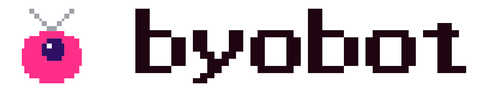

<picture>
  <source media="(prefers-color-scheme: dark)" srcset="docs/assets/byobot_banner_dark.svg">
  
</picture>

an open source personal health operating system. you own all your own data locally. bring any agent.

byobot keeps your training and health data in one SQLite database on your machine. Any agent can read it and write plans to it through a CLI or an MCP server, and an iPhone app logs workouts offline and syncs with your laptop over your local network.

Pre-alpha: not yet on PyPI or the App Store.

## Quickstart

Needs Python 3.10 or newer.

```bash
git clone https://github.com/byobot/byobot.git
pip install ./byobot/python

byobot init    # creates ~/.byobot/byobot.db
byobot log effort.performed '{"activity_id": "barbell_back_squat", "metrics": {"reps": {"value": 5}, "load": {"value": 100, "unit": "kg"}}}'
byobot query "SELECT activity_id, reps, load_kg FROM strength_sets"
```

`byobot` lists every command. Each prints JSON.

## Connect an agent

```bash
claude mcp add byobot -- byobot mcp
```

Other MCP clients: `{"mcpServers": {"byobot": {"command": "byobot", "args": ["mcp"]}}}`

To have it plan your week, run its `weekly_plan` prompt (`/mcp__byobot__weekly_plan` in Claude Code).

## Pair the iPhone app

Run `byobot serve` and scan the QR code it shows. To build the app, see [`apps/ios`](apps/ios).

## More

- [`schema/`](schema): the data contract
- [`library/`](library): the exercises byobot ships
- [`CONTRIBUTING.md`](CONTRIBUTING.md), [`SECURITY.md`](SECURITY.md), [`CODE_OF_CONDUCT.md`](CODE_OF_CONDUCT.md)

## License

[Apache-2.0](LICENSE)
